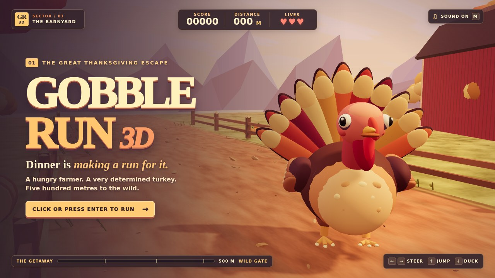
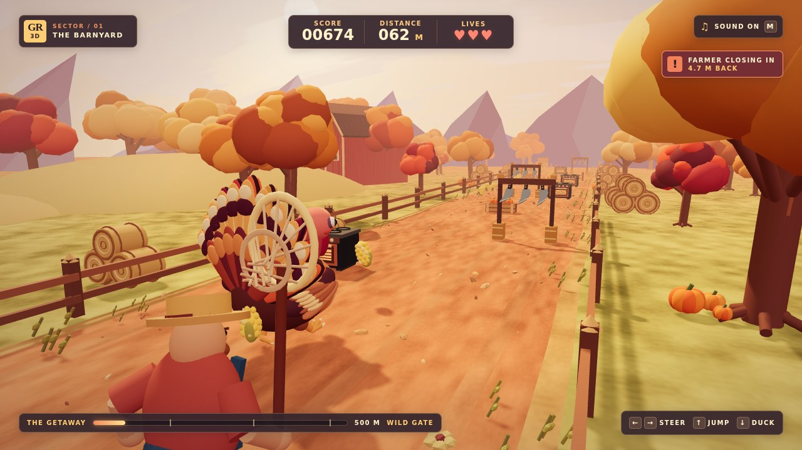
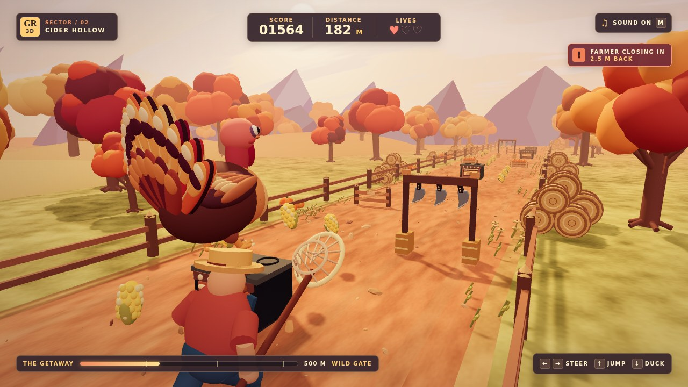
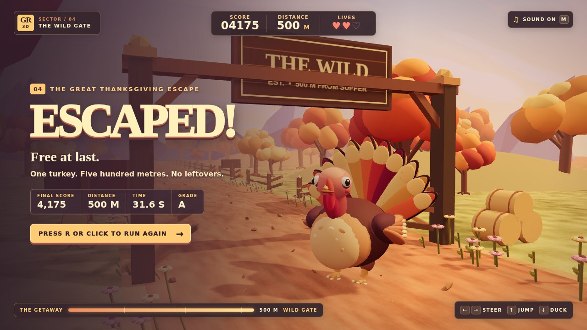

# turkey-run-game-01

## Gobble Run 3D

Dinner is making a run for it. Race 500 metres down a fenced autumn farm lane to the wild gate. Jump ovens, duck swinging knife gates, and weave past pumpkin crates and fences. Follow the sweet-corn trails to build a score streak. Each hit costs a heart and gives the farmer a chance to close in; bank your remaining hearts for a finish bonus.

### Play offline

Run `node serve.ts` with Node.js 22.18 or later and visit `http://127.0.0.1:8080/` in desktop Chrome. There is no install or build step and no internet access is needed. You can also open `game/index.html` directly: if Chrome blocks sibling module imports on `file://`, select the `game` folder in the page’s picker to grant it read access to the local files. Nothing is uploaded.

| Action | Controls |
| --- | --- |
| Start | Enter or click |
| Steer one lane | Left/Right arrows or A/D |
| Jump | Up arrow, W, or Space |
| Duck / slide | Down arrow or S |
| Toggle sound | M or click the sound button |
| Restart | R or click after a run |

The course, models, lighting, and music are generated in code. The only runtime library is the local MIT build of three.js r160. To try another course, append `?seed=42` to the game URL.

### Gallery

Four real WebGL frames, all 1280×720: [1-title.jpg](screenshots/1-title.jpg), [2-chase.jpg](screenshots/2-chase.jpg), [3-near.jpg](screenshots/3-near.jpg), [4-end.jpg](screenshots/4-end.jpg).

| The chase | A close call | Across the gate |
| --- | --- | --- |
|  |  |  |

Entered on [make.fun](https://make.fun/bounty/turkey-run-game-01).
